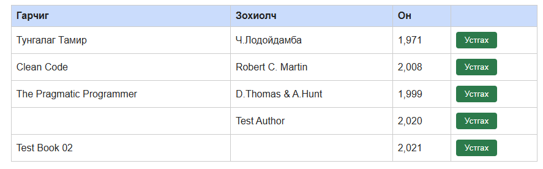

# BUG-01 — Заавал бөглөх талбаруудыг шалгахгүй байна

## Орчин
- Апп: Уншлагын жагсаалт v2.0
- OS: Windows + Ubuntu (WSL)
- Browser: Microsoft Edge 155.0.4283.62
- Огноо: 2026-10-21
- Tour: Couch Potato Tour

## Урьдчилсан нөхцөл
Апп `http://localhost:3000` хаягт ажиллаж байна.

## Дахин үүсгэх алхмууд
1. `http://localhost:3000` хаягийг нээнэ.
2. Номын гарчгийг хоосон үлдээнэ.
3. Зохиогчийн талбарт `Test Author` оруулна.
4. Он талбарт `2020` оруулна.
5. `Нэмэх` товчийг дарна.

## Хүлээгдсэн үр дүн
Гарчиг заавал бөглөх талбар тул ном нэмэгдэхгүй, алдааны мэдэгдэл гарах ёстой.

## Бодит үр дүн
`Ном нэмэгдлээ` гэсэн мэдэгдэл гарч, гарчиггүй ном жагсаалтад нэмэгдсэн.

Нэмэлт шалгалтаар зохиогчийн талбарыг хоосон үлдээхэд мөн ном нэмэгдсэн.

## Severity
Major — Дутуу мэдээлэлтэй ном нэмэгдэж, өгөгдлийн бүрэн бүтэн байдал алдагдаж байна.

## Evidence

## Session
`session-report.md` — 17:12, 17:19, 17:21.
