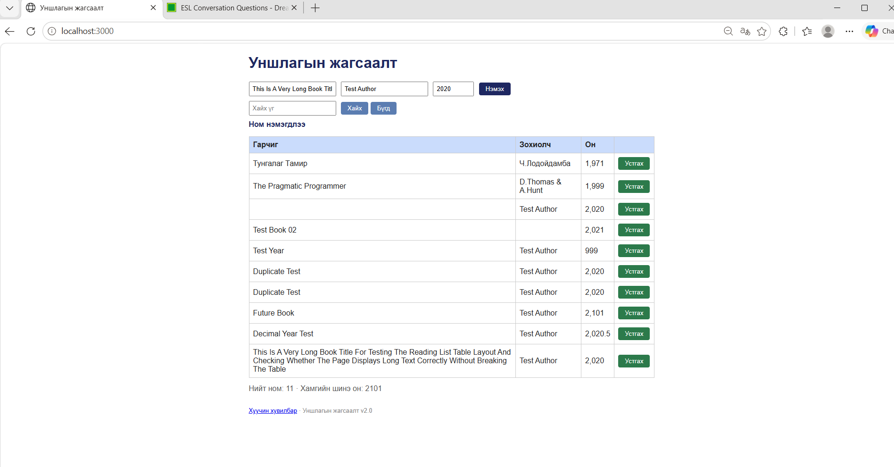

# BUG-02 — Номын хэвлэгдсэн оны шалгалт ажиллахгүй байна

## Орчин
- Апп: Уншлагын жагсаалт v2.0
- OS: Windows + Ubuntu (WSL)
- Browser: Microsoft Edge 155.0.4283.62
- Огноо: 2026-10-21
- Tour: Couch Potato Tour

## Урьдчилсан нөхцөл
Апп `http://localhost:3000` хаягт ажиллаж байна.
Ном нэмэх форм нээлттэй байна.

## Дахин үүсгэх алхмууд
1. `http://localhost:3000` хаягийг нээнэ.
2. Гарчигт `Test Year` оруулна.
3. Зохиогчид `Test Author` оруулна.
4. Он талбарт `999` оруулна.
5. `Нэмэх` товчийг дарна.
6. Дараах утгуудыг тус тусад нь мөн туршина:
   - `Future Book`, `Test Author`, `2101`
   - `Decimal Year Test`, `Test Author`, `2020.5`

## Хүлээгдсэн үр дүн
Он нь 1000–2100 хоорондох бүхэл тоо байх ёстой.
Хязгаараас гадуурх болон бутархай оныг
хүлээн авахгүй, алдааны мэдэгдэл харуулах ёстой.

## Бодит үр дүн
`999`, `2101`, `2020.5` гэсэн онтой номууд
бүгд амжилттай нэмэгдэж, жагсаалтад харагдсан.

## Severity
Major — Хүчингүй онтой ном нэмэгдэх боломжтой
байгаа нь өгөгдлийн чанарт нөлөөлж байна.

## Evidence

## Session
`session-report.md` — 17:24, 17:42, 17:45.

