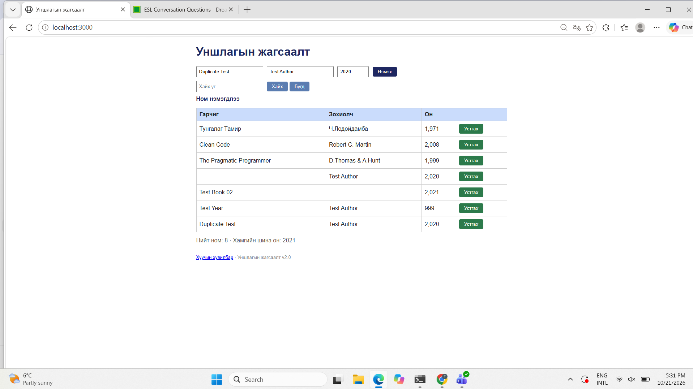

# BUG-04 — Давхардсан ном нэмэгдэж байна

## Орчин
- Апп: Уншлагын жагсаалт v2.0
- OS: Windows + Ubuntu (WSL)
- Browser: Microsoft Edge 155.0.4283.62
- Огноо: 2026-10-21
- Tour: Couch Potato Tour

## Урьдчилсан нөхцөл
Апп `http://localhost:3000` хаягт ажиллаж байна.
Ном нэмэх форм нээлттэй байна.

## Дахин үүсгэх алхмууд
1. `http://localhost:3000` хаягийг нээнэ.
2. Дараах мэдээлэлтэй ном нэмнэ:
   - Гарчиг: `Duplicate Test`
   - Зохиогч: `Test Author`
   - Он: `2020`
3. `Нэмэх` товчийг дарна.
4. Яг ижил мэдээллийг дахин оруулна.
5. `Нэмэх` товчийг дахин дарна.
6. Номын жагсаалтыг шалгана.

## Хүлээгдсэн үр дүн
Ижил гарчиг, зохиогчтой ном аль хэдийн байгаа
тохиолдолд хоёр дахь ном нэмэгдэхгүй байх ёстой.
Хэрэглэгчид давхардсан номын тухай мэдэгдэл гарна.

## Бодит үр дүн
`Duplicate Test` нэртэй, `Test Author` зохиогчтой,
`2020` онтой хоёр ном хоёулаа жагсаалтад нэмэгдсэн.

Ном нэмэх бүрд `Ном нэмэгдлээ` гэсэн мэдэгдэл
гарсан. Нийт номын тоо 9 болсон.

## Severity
Major — Давхардсан бүртгэл үүсэж, номын жагсаалтын
өгөгдлийн чанар болон найдвартай байдалд нөлөөлж байна.

## Evidence

## Session
`session-report.md` — 17:32.
