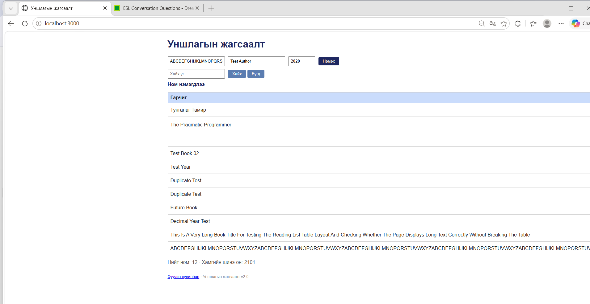

# BUG-08 — Хэт урт гарчиг хүснэгтийн байрлалыг эвдэж байна

## Орчин
- Апп: Уншлагын жагсаалт v2.0
- OS: Windows + Ubuntu (WSL)
- Browser: Microsoft Edge 155.0.4283.62
- Огноо: 2026-10-21
- Tour: Couch Potato Tour

## Урьдчилсан нөхцөл
Апп `http://localhost:3000` хаягт ажиллаж байна.
Ном нэмэх форм нээлттэй байна.

## Дахин үүсгэх алхмууд
1. `http://localhost:3000` хаягийг нээнэ.
2. Гарчгийн талбарт дараах текстийг хоосон зайгүйгээр оруулна:

   `ABCDEFGHIJKLMNOPQRSTUVWXYZ` гэсэн 26 тэмдэгтийг
   8 удаа дараалан давтана.

3. Зохиогчийн талбарт `Test Author` оруулна.
4. Он талбарт `2020` оруулна.
5. `Нэмэх` товчийг дарна.
6. Номын жагсаалтын байрлалыг шалгана.

## Хүлээгдсэн үр дүн
Хэт урт гарчиг баганын өргөнд тохирч,
шаардлагатай үед дараагийн мөрөнд шилжих ёстой.

Зохиогч, он болон устгах товч дэлгэцийн
харагдах хэсэгт хэвийн байрлах ёстой.

## Бодит үр дүн
Ном амжилттай нэмэгдсэн боловч урт гарчиг
дараагийн мөрөнд шилжээгүй.

Гарчгийн багана хэт өргөсөж, зохиогч,
он болон "Устгах" товчны баганууд
дэлгэцээс хальж харагдахгүй болсон.

## Severity
Major — Хэт урт гарчиг оруулахад хүснэгтийн
байрлал эвдэрч, бусад мэдээлэл болон
устгах товчийг ашиглахад хүндрэл үүсэж байна.

## Evidence

## Session
`session-report.md` — 17:48.

