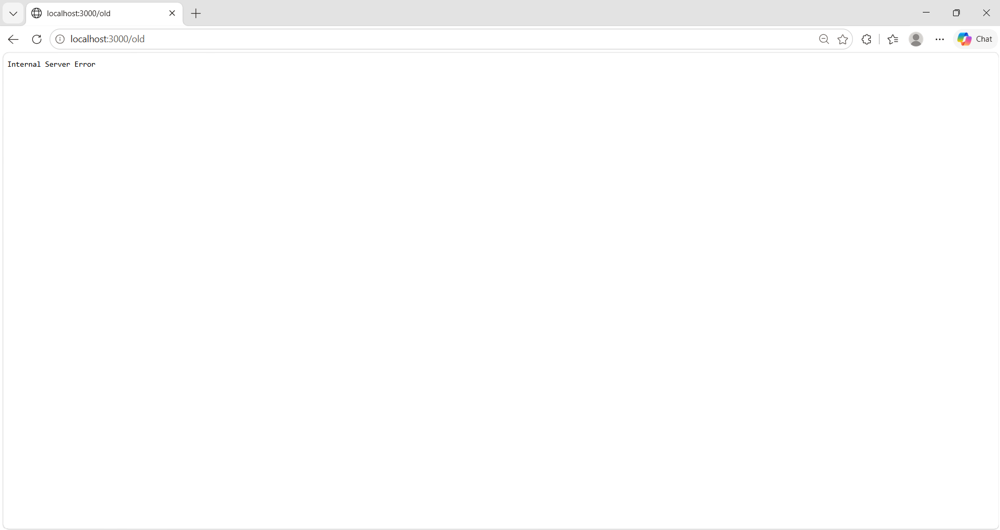

# BUG-09 — "Хуучин хувилбар" холбоос ажиллахгүй байна

## Орчин
- Апп: Уншлагын жагсаалт v2.0
- OS: Windows + Ubuntu (WSL)
- Browser: Microsoft Edge 155.0.4283.62
- Огноо: 2026-10-21
- Tour: Нэмэлт холбоосын шалгалт

## Урьдчилсан нөхцөл
Апп http://localhost:3000 хаягт ажиллаж байна.

## Дахин үүсгэх алхмууд
1. http://localhost:3000 хаягийг нээнэ.
2. Хуудасны доод хэсгийн "Хуучин хувилбар" холбоос дээр дарна.
3. Нээгдсэн хуудсыг шалгана.

## Хүлээгдсэн үр дүн
Хуучин хувилбарын хуудас алдаагүй нээгдэх ёстой.

## Бодит үр дүн
http://localhost:3000/old хаягт "Internal Server Error" гарсан.
Хуудасны агуулга харагдаагүй.

## Severity
Major — Хэрэглэгч хуучин хувилбарын хуудсанд хандах боломжгүй байна.

## Evidence

## Session
`session-report.md` — 17:53.

