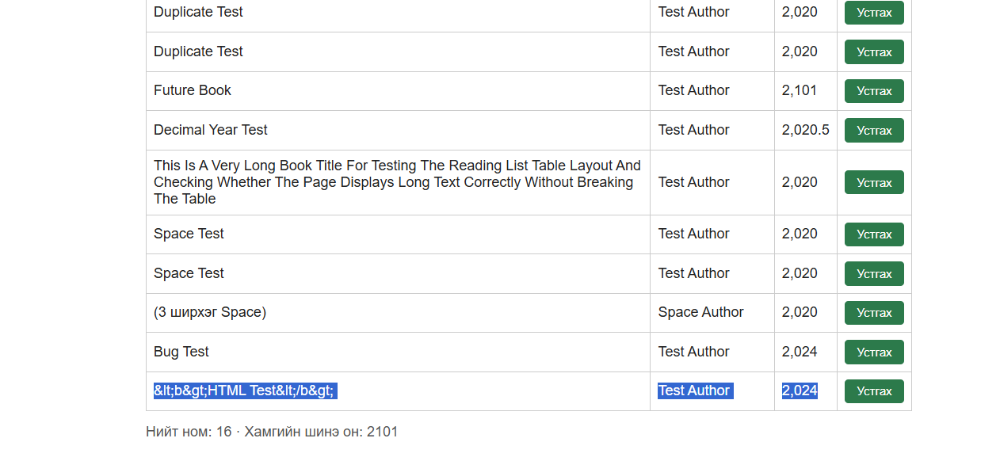

# BUG-11 — HTML тэмдэгтүүд буруу харагдаж байна

## Орчин
- Апп: Уншлагын жагсаалт v2.0
- OS: Windows + Ubuntu (WSL)
- Browser: Microsoft Edge 155.0.4283.62
- Огноо: 2026-10-21
- Tour: Нэмэлт оролт болон дүрслэлийн шалгалт

## Урьдчилсан нөхцөл
Апп `http://localhost:3000` хаягт ажиллаж байна.
Ном нэмэх форм нээлттэй байна.

## Дахин үүсгэх алхмууд
1. `http://localhost:3000` хаягийг нээнэ.
2. Гарчигт `<b>HTML Test</b>` оруулна.
3. Зохиогчид `Test Author` оруулна.
4. Он талбарт `2024` оруулна.
5. `Нэмэх` товчийг дарна.
6. Нэмэгдсэн номын гарчгийг шалгана.

## Хүлээгдсэн үр дүн
HTML код ажиллахгүй, номын гарчиг
`<b>HTML Test</b>` гэсэн энгийн текстээр
харагдах ёстой.

## Бодит үр дүн
Номын гарчиг дараах байдлаар харагдсан:

`&lt;b&gt;HTML Test&lt;/b&gt;`

`<` болон `>` тэмдэгтүүд HTML entity
хэлбэрээр харагдаж байна.

## Severity
Minor — Номын гарчгийн тэмдэгтүүд буруу
харагдаж, уншихад ойлгомжгүй болж байна.

## Evidence

## Session
`session-report.md` — 18:07.
